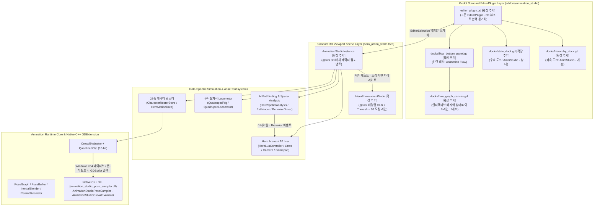
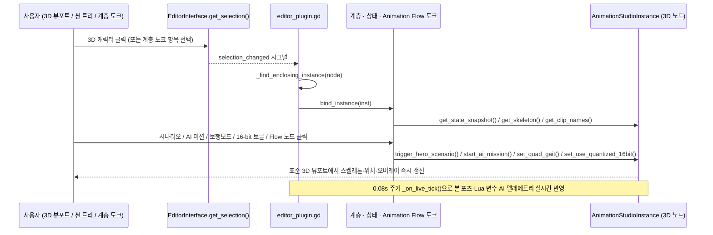

# PlayForge Animation Studio — 현재 구현 상태 · 구조 · 기능 · Class · API 종합 명세서

- **작성일**: 2026-11-27
- **브랜치 / 기준 커밋**: `Forge-Refactoring-AnimationStudio` (`d4c474cf29e`, 포크 엔진 베이스 `814b87c8386`)
- **대상 엔진**: Godot `4.7.2` 로컬 포크 (`Forge-Refactoring-engine`, `4.7.2.stable.custom_build.31e7ebb19`) 및 Godot `4.7.2` Web Editor (WASM)
- **핵심 원칙**: `.hkt` 및 외부 SDK 런타임 의존성 **0건** (모든 스킨·모션·배경맵·스크립트·AI 공간 분석이 100% Godot 네이티브 리소스 및 확장으로 내재화됨)

---

## 1. 엔진 영향 범위 및 변경 성격 분류

> 본 Animation Studio 작업(`814b87c8386..HEAD`)의 모든 변경사항을 4가지 기준으로 분류한 결과입니다.

- **`[엔진 수정]`**: **없음 (0건)** — Godot 코어(`core/`, `scene/`, `servers/`, `modules/`, `editor/`, `main/`) 기존 파일 수정 없음
- **`[엔진 추가]`**: **없음 (0건)** — Godot 코어 신규 파일·모듈 추가 없음
- **`[확장 수정]`**: `playforge/tests/run.py`, `.gitattributes`, `playforge/ANIMATION_STUDIO_REVIEW.md` 등 기존 테스트 러너·인프라·문서 보강
- **`[확장 추가]`**: `playforge/animation_studio/` 이하 전체 애드온(`addons/animation_studio/`), C++ GDExtension(`native/`), 28종 내재화 캐릭터(`characters/`, `hero/`, `soldier/`), 4족 절차적 Locomotor(`quadruped/`), Hero 배경맵·10종 Lua 복원(`hero/arena/`), AI Pathfinding·Spatial Analysis(`hero/ai/`), 웹 에디터·로컬 포크 런처(`web_editor/`, `*.cmd`), 회귀 테스트(`tests/`)

---

## 2. 전체 구현 상태 요약

| 영역 | 구현 상태 | 핵심 성과 / 실측 지표 | 검증 스위트 |
| :--- | :---: | :--- | :--- |
| **코어 포즈 런타임 & C++ GDExtension** | 완료 | 16-bit `QuantizedClip` 메모리 **73.0% 절감**, 8T C++ 병렬 크라우드 평가 **65본×200체 0.59ms / 114본×200체 1.18ms** (포즈 기준 7.2~16.0배 가속), 관성 블렌딩·상체 마스크·Rewind·능동 랙돌 | `animation_coexistence` · `animation_graph_rewind` · `animation_crowd_benchmark` · `animation_active_ragdoll` · `animation_pose_parity` · `animation_compressed_parity` |
| **표준 Godot EditorPlugin 도킹 애드온** | 완료 | `_has_main_screen()=false` 표준 애드온 전환, Godot 기본 **3D 뷰포트** + 도킹 가능 패널 3종(`AnimStudio · 계층`, `AnimStudio · 상태`, `Animation Flow`), 배치 인스턴스 양방향 선택·28종 즉시 스폰 | `animation_editor_docks` (**7/7 PASS**), 로컬 포크 에디터 & 웹 에디터 라이브 검증 |
| **28종 내재화 캐릭터 로스터** | 완료 | 총 **28종 · 1,863본 · 119메시 · 225,471정점 · 83클립** (`.glb` + 압축 `HeroMotionData` `.res`, SDK 토큰 0건), Float32 vs 16-bit C++ 실시간 비교 & 9체 퍼레이드 | `animation_character_roster` (**5/5 PASS**), `animation_soldier_compare` (**7/7 PASS**) |
| **Hero 배경맵 & 10종 Lua 복원** | 완료 | `hero_environment.glb` (4,992정점·1,664삼각형·CompleteMap+1m그리드 셰이더), **31클립**, **90개 도킹 라인**, 10종 Lua 로직 1:1 GDScript 복원, 엄폐·등반·난간넘기 좌표/오프셋 교정 | `animation_hero_arena` (**9/9 PASS**) |
| **4족 절차적 Locomotor** | 완료 | 클립 0개, 28본 프로시저럴 릭 + Walk/Trot/Pace/Gallop 보행 스케줄러 + 지면 접지 월드락(`0.0mm` 슬립) + 4지 2-Bone IK + 제작 과정 리플레이 | `animation_quadruped_locomotor` (**12/12 PASS**) |
| **AI Pathfinding · Spatial Analysis · AI+Behavior** | 완료 | 다층 2.5D NavGraph(**1,823 NavNodes · 13,472 WalkEdges**), 6종 공간 분석기 **140개 UserEdges**, 4종 `CostModifier`, 동적 장애물 회피, 텔레포트 없는 **지하 참호(`-3m`)~정상(`+10.25m`) 12/12 기능 자율 완주** | `animation_hero_ai_pathfinding` (**8/8 PASS**) |
| **로컬 포크 빌드/실행 & 웹 에디터** | 완료 | 원클릭 `.cmd` 3종(엔진/C++ DLL 빌드·테스트·실행), 루프백 전용 `/local-fork`·`/launch-local-editor`·`/launch-local-demo`, 전체 창 `iframe(canvasResizePolicy=2)` 웹 에디터 + HTTPS 외부 터널 | 로컬 포크 7종 핵심 스위트 **61/61 PASS** |

---

## 3. 시스템 아키텍처 및 데이터 흐름

### 3.1 모듈 계층도



### 3.2 에디터 도크 선택 동기화 시퀀스



---

## 4. 디렉터리 구조

```text
playforge/animation_studio/
├── addons/animation_studio/           # [확장 추가] 표준 Godot EditorPlugin + 런타임 코어
│   ├── plugin.cfg                     # 플러그인 매니페스트 (v1.2, Standard 3D Docks)
│   ├── editor_plugin.gd               # 표준 EditorPlugin (3D 뷰포트 + 3종 도킹 패널)
│   ├── animation_studio_instance.gd   # @tool AnimationStudioInstance (3D 배치 컴포넌트)
│   ├── docks/                         # 표준 도킹 UI 3종
│   │   ├── hierarchy_dock.gd          # 좌측 도크: AnimStudio · 계층
│   │   ├── state_dock.gd              # 우측 도크: AnimStudio · 상태
│   │   ├── flow_bottom_panel.gd       # 하단 패널: Animation Flow
│   │   └── flow_graph_canvas.gd       # 인터랙티브 베지어 플로우 그래프 캔버스
│   ├── pose_clip.gd / pose_modifier.gd / pose_buffer.gd
│   ├── pose_graph.gd / pose_graph_modifier.gd / inertial_blender.gd
│   ├── crowd_evaluator.gd / rewind_recorder.gd / active_ragdoll_joint.gd
│   └── bin/                           # Windows x64 C++ GDExtension 출력 (DLL + .gdextension)
├── native/                            # [확장 추가] C++ GDExtension 소스 & SConstruct
│   ├── SConstruct
│   ├── animation_studio_pose_sampler.cpp
│   └── animation_studio_crowd_evaluator.h / .cpp
├── characters/                        # [확장 추가] 전체 28종 내재화 캐릭터 로스터
│   ├── catalog.json / character_store.gd / character_showcase.tscn / .gd
│   └── assets/*.glb, *_motion.res     # 내재화 GLB/RES 에셋 (SDK 의존성 0)
├── hero/                              # [확장 추가] Hero 85본 스튜디오 · 배경맵 · Lua · AI
│   ├── hero_motion_data.gd / hero.gd / locomotion.gd / terrain_ik.gd
│   ├── hero_locomotion_studio.tscn/.gd / authoring_replay.gd / authoring_cursor_overlay.gd
│   ├── hero_sm_canvas.gd / morpheme_timeline_canvas.gd
│   ├── assets/                        # hero_skin.glb, hero_environment.glb, hero_*_motion.res, hero_arena_lines.json
│   ├── arena/                         # Hero 배경맵 + 10종 Lua 복원
│   │   ├── hero_arena_world.tscn      # 표준 3D 뷰포트 기본 씬 (4캐릭터 광장 배치)
│   │   ├── hero_environment_node.gd   # @tool HeroEnvironmentNode (CompleteMap+1m 그리드 + 90 도킹 라인)
│   │   ├── hero_lua_controller.gd / hero_lua_lines.gd / hero_lua_camera.gd / hero_lua_gamepad.gd
│   │   └── hero_arena.tscn / .gd      # 단독 플레이 가능 아레나
│   └── ai/                            # AI Pathfinding · Spatial Analysis · AI+Behavior
│       ├── hero_spatial_analysis.gd   # 다층 2.5D NavGraph + 6종 Traversal UserEdges
│       ├── hero_ai_pathfinder.gd      # 3D A* + 4종 CostModifier + 동적 장애물 회피
│       ├── hero_ai_behavior_driver.gd # AI + Behavior 브리지 (12/12 기능 자율 주행)
│       └── hero_ai_demo.tscn / .gd    # 단독 AI 길찾기 데모
├── quadruped/                         # [확장 추가] 4족 절차적 Locomotor (28본 · 0클립)
├── soldier/                           # [확장 추가] Soldier 114본 · M4 소총 비교 데모
├── catalog/ & demo/                   # [확장 추가] 138종 Behavior 사례 갤러리 & Animation Lab
├── web_editor/                        # [확장 추가] Godot 4.7.2 Web Editor + 로컬 포크 런처 서버
│   ├── serve_web_editor.cjs / index.html / editor_frame.html / local_fork.html
├── tests/                             # [확장 추가] 헤드리스 회귀 테스트 스위트
├── docs/                              # [확장 추가] 아키텍처·API 문서 & UI/UX 디자인 시안 요청서
├── build_and_test_local_fork.cmd      # [확장 추가] 로컬 포크 빌드 + 7종 테스트 + 실행 배치
├── open_local_fork_editor.cmd         # [확장 추가] 로컬 포크 에디터 즉시 실행 배치
└── run_local_fork_demo.cmd            # [확장 추가] 로컬 포크 데모 선택 실행 배치
```

---

## 5. Class 및 공개 API 레퍼런스

### 5.1 표준 Godot 에디터 확장 (`addons/animation_studio/`)

#### 1) `EditorPlugin` — `addons/animation_studio/editor_plugin.gd` `[확장 추가]` (`@tool`, `extends EditorPlugin`)
- **역할**: 표준 Godot 에디터 플러그인 진입점. `_has_main_screen() -> false`로 Godot 기본 `3D` 뷰포트를 유지하고 3개 표준 도킹 패널을 등록·동기화합니다.
- **도킹 슬롯 등록**:
  - `EditorPlugin.DOCK_SLOT_LEFT_BR` → `AnimStudio · 계층` (`hierarchy_dock.gd`)
  - `EditorPlugin.DOCK_SLOT_RIGHT_BL` → `AnimStudio · 상태` (`state_dock.gd`)
  - `add_control_to_bottom_panel(..., "Animation Flow")` → `Animation Flow` (`flow_bottom_panel.gd`)
- **도구 메뉴 항목 (`프로젝트 → 도구`)**:
  - `Animation Studio · 3D 아레나 씬 열기 (표준 뷰포트)` (`res://hero/arena/hero_arena_world.tscn`)
  - `Animation Studio · Animation Flow 하단 패널 열기`
  - `Animation Studio · 4족 절차적 Locomotor 씬 열기`
  - `Animation Studio · Hero 상태머신 스튜디오 씬 열기`
  - `Animation Studio · Soldier 114본 · M4 비교 씬 열기`
  - `Animation Studio · 전체 28종 캐릭터 로스터 씬 열기`
  - `Animation Studio · Hero 배경맵 단독 데모 씬 열기`
  - `Animation Studio · AI Pathfinding Hero 전체 맵 데모 열기`
- **자동 동기화 동작**: `EditorInterface.get_selection().selection_changed` 및 `scene_changed` 수신 → `AnimationStudioInstance` 탐색 → 3개 도크 동시 바인딩 + 바인딩 대상이 2.5m 이상 이동 시 3D 뷰포트 `Focus Selection` 자동 호출.

#### 2) `AnimationStudioInstance` — `addons/animation_studio/animation_studio_instance.gd` `[확장 추가]` (`@tool class_name AnimationStudioInstance extends Node3D`)
- **역할**: 표준 3D 뷰포트 씬에 배치되는 통합 캐릭터 인스턴스 컴포넌트. 클릭 선택 그룹(`_edit_group_`)과 3D 선택 프록시를 포함합니다.
- **`@export` 속성**:
  | 속성 | 타입 | 기본값 | 설명 |
  | :--- | :--- | :--- | :--- |
  | `role` | `String` (`hero_arena` \| `quadruped` \| `character`) | `"character"` | 인스턴스 구동 역할 (변경 시 자동 리빌드) |
  | `character_id` | `String` | `"soldier"` | 28종 로스터 ID (`role=="character"`일 때 적용) |
  | `playing` | `bool` | `true` | 에디터/런타임 실시간 재생 여부 |
  | `auto_demo` | `bool` | `true` | Hero 자동 파쿠르 투어 / 4족 순환 보행 활성 |
  | `ai_driven` | `bool` | `false` | `hero_arena` 역할의 AI Pathfinding 자율 주행 모드 |
  | `use_quantized_16bit` | `bool` | `false` | 28종 캐릭터 16-bit C++ `QuantizedClip` 평가 전환 |
  | `playback_speed` | `float` (`0.1..2.0`) | `1.0` | 재생 배속 |
- **주요 공개 API**:
  - `rebuild_instance() -> void`: 현재 `role`/`character_id`에 맞춰 스켈레톤·메시·컨트롤러 재구축
  - `step_once(dt: float) -> void`: 일시정지 상태에서도 정확히 `dt`만큼 1스텝 진행 (`+1/60s` 버튼 연동)
  - `get_skeleton() -> Skeleton3D` / `get_display_title() -> String` / `get_clip_names() -> PackedStringArray`
  - `select_clip(clip_name: String) -> void` / `seek_time(t: float) -> void` / `sample_roster_at(t: float) -> void`
  - **Hero 제어**: `trigger_hero_scenario(scenario_id: String)` (`locomotion|cover|vault|climb|leap|strafe`), `raise_hero_event(event_name: String) -> bool`
  - **AI 제어**: `set_ai_driven(enabled: bool)`, `start_ai_mission(mission_id: String)`, `set_ai_cost_mode(mode: String)`
  - **4족 제어**: `set_quad_speed(v: float)`, `set_quad_gait(g: String)` (`auto|walk|trot|pace|gallop`)
  - **로스터 비교/벤치마크**: `set_use_quantized_16bit(v: bool)`, `run_crowd_benchmark_200() -> Dictionary` (`{agents, bones_per_tick, ms, native}`)
  - **통합 텔레메트리**: `get_state_snapshot() -> Dictionary` (역할별 상태·클립·시간·본 수·좌표·Lua 변수·AI 텔레메트리·4족 발 접지·16-bit 오차 지표 반환)

#### 3) 표준 도킹 패널 3종 (`addons/animation_studio/docks/`) `[확장 추가]`
| 스크립트 | 기반 클래스 | 시그널 (`signal`) | 공개 메서드 |
| :--- | :--- | :--- | :--- |
| `hierarchy_dock.gd` (`AnimStudio · 계층`) | `VBoxContainer` (`@tool`) | `instance_selected(inst: Node3D)`<br>`spawn_requested(role: String, character_id: String)`<br>`focus_requested(inst: Node3D)`<br>`refresh_requested()` | `set_scene_instances(instances, active)`<br>`bind_instance(inst)`<br>`update_live()` |
| `state_dock.gd` (`AnimStudio · 상태`) | `VBoxContainer` (`@tool`) | `docking_lines_toggled(visible: bool)` | `bind_instance(inst)`<br>`update_live()` |
| `flow_bottom_panel.gd` (`Animation Flow`) | `VBoxContainer` (`@tool`) | *(내부 캔버스 클릭을 바인딩 인스턴스에 직접 전달)* | `bind_instance(inst)`<br>`update_live()` |
| `flow_graph_canvas.gd` | `Control` (`@tool`) | `node_clicked(node_id: String)` | `set_flow_state(role, active_state, sub_label)` |

---

### 5.2 런타임 코어 & C++ GDExtension (`addons/animation_studio/`, `native/`)

| 클래스 / 파일 | 변경 성격 | 기반 | 주요 공개 API |
| :--- | :---: | :--- | :--- |
| `AnimationStudioPoseSampler`<br>(`native/animation_studio_pose_sampler.cpp`) | `[확장 추가]` | C++ `RefCounted` | `configure(...) -> bool`, `apply_pose(skeleton, time) -> void` |
| `AnimationStudioCrowdEvaluator`<br>(`native/animation_studio_crowd_evaluator.h/.cpp`) | `[확장 추가]` | C++ `RefCounted` | `configure(bone_count, key_count, duration, sample_rate, pos_min, pos_range, pos_q, rot_q, agent_count, thread_count=0) -> bool`<br>`step_parallel(delta, skeletons) -> Dictionary`<br>`get_worker_count() -> int` |
| `crowd_evaluator.gd` + 내부 `QuantizedClip` | `[확장 추가]` | `RefCounted` | `static native_available() -> bool`, `is_using_native() -> bool`, `setup(clip, agents, use_native, threads)`, `step_parallel(delta, skeletons) -> Dictionary`<br>`QuantizedClip.bake_from_animation(anim, skel, fps)`, `resident_bytes()`, `uncompressed_bytes(...)` |
| `pose_graph.gd` | `[확장 추가]` | `RefCounted` | `configure(root_motion_bone)`, `add_state(...)`, `reset(initial)`, `transition_to(...)` (`SynchronizedStart`, `ping_pong`, `enforced_duration`), `return_to_previous(dur)`, `play_slot(...)`, `cancel_slot(...)`, `evaluate(delta)` |
| `pose_buffer.gd` | `[확장 추가]` | `RefCounted` | `create_rest(skel)`, `capture_from_skeleton(skel)`, `build_branch_mask(skel, root_bone)`, `sample_animation(...)`, `blend_masked(...)`, `apply_to_skeleton(skel)`, `max_diff(other)` |
| `inertial_blender.gd` | `[확장 추가]` | `RefCounted` | `reset()`, `is_active()`, `remaining_time()`, `progress()`, `record_output(pose, dt)`, `trigger(target_pose, dur)`, `apply(target_pose, dt)` |
| `pose_modifier.gd` / `pose_clip.gd` / `pose_graph_modifier.gd` | `[확장 추가]` | `SkeletonModifier3D` / `RefCounted` | `play_clip(player, clip_name) -> bool`, `stop_clip()`, `configure(...)`, `apply_pose(...)` |
| `rewind_recorder.gd` | `[확장 추가]` | `RefCounted` | `attach(skel, max_frames)`, `detach()`, `clear()`, `queue_metadata(meta)`, `get_frame_count()`, `get_frame(idx)`, `apply_frame(idx)` |
| `active_ragdoll_joint.gd` | `[확장 추가]` | `Node3D` | `build_rig()`, `get_joint_angle_z() -> float`, `step_control() -> float`, `teleport_reset(xform)` |

---

### 5.3 캐릭터 로스터 · Hero 배경맵/Lua · 4족 Locomotor

| 클래스 / 파일 | 변경 성격 | 기반 | 주요 공개 API |
| :--- | :---: | :--- | :--- |
| `CharacterRosterStore`<br>(`characters/character_store.gd`) | `[확장 추가]` | `@tool RefCounted` | `static load_catalog(force_reload=false) -> Array[Dictionary]`, `static get_entry(char_id)`, `static load_motion_dict(char_id)`, `static populate_skeleton(skel, dict)`, `static build_animation_from_clip(dict, clip, rig_name)`, `static attach_skin_to_skeleton(char_id, rig)`, `static build_rig(char_id, root_name)`, `static compute_pose_aabb(skel)`, `static apply_quantized_to_skeleton(qclip, skel, t)` |
| `HeroMotionData`<br>(`hero/hero_motion_data.gd`) | `[확장 추가]` | `@tool Resource` | `@export schema_version, bone_names, bone_parents, bone_binds, packed_clips`<br>`pack_from_dict(raw)`, `to_motion_dict() -> Dictionary`, `static load_motion_dict()` |
| `HeroEnvironmentNode`<br>(`hero/arena/hero_environment_node.gd`) | `[확장 추가]` | `@tool Node3D` | `@export show_docking_lines: bool`<br>`refresh_docking_lines(highlight_index=-1)` (CompleteMap 톤 보정 + 1m/5m 바닥 그리드 셰이더 + 트라이메시 충돌) |
| `HeroLuaController`<br>(`hero/arena/hero_lua_controller.gd`) | `[확장 추가]` | `@tool RefCounted` | `init_world() -> int`, `teleport_hero(pos, yaw, clear_dock=true)`, `step(dt, skel, raycast_fn)`, `raise_event(event_name, raycast_fn) -> bool`, `jump_actions(raycast_fn)`, `vault_low_wall(...)`, `jump_to_platform(line)`, `try_catch_platform()`, `undock_platform(raycast_fn)`, `take_cover()`, `cover_to_cover()`, `come_out_of_cover()`, `leap_to_platform(line, raycast_fn)` |
| `HeroLuaLines`<br>(`hero/arena/hero_lua_lines.gd`) | `[확장 추가]` | `@tool RefCounted` | `load_lines() -> int` (90개 도킹 라인), `closest_point_on_line(line, pos)`, `find_line_to_dock_to(...)`, `set_line_docking_target(line)`, `set_plane_docking_target(n, p)`, `clear_docking_target()`, `build_debug_lines_mesh(hl_idx)` |
| `HeroLuaCamera` / `HeroLuaGamepad`<br>(`hero/arena/hero_lua_camera.gd`, `hero_lua_gamepad.gd`) | `[확장 추가]` | `@tool RefCounted` | `reset_behind(...)`, `add_mouse_orbit(delta_px)`, `update(...)` / `set_raw_input(lx, ly, rx, ry, lt)`, `is_left_stick_stationary()`, `in_left_stick_in_dead_zone()` |
| `QuadrupedRig` / `QuadrupedLocomotor`<br>(`quadruped/quadruped_rig.gd`, `quadruped_locomotor.gd`) | `[확장 추가]` | `@tool RefCounted` | `static build_skeleton(rig) -> Dictionary`, `static build_visual_body(rig) -> Array[Node3D]`<br>`setup(rig, root_node, bone_ids)`, `step(desired_dir, desired_speed, delta, stage=5) -> Dictionary`, `static terrain_height(x, z)`, `static demo_course_command(tick)` |

---

### 5.4 AI Pathfinding · Spatial Analysis · AI+Behavior (`hero/ai/`)

| 클래스 / 파일 | 변경 성격 | 기반 | 주요 공개 API 및 상수 |
| :--- | :---: | :--- | :--- |
| `HeroSpatialAnalysis`<br>(`hero/ai/hero_spatial_analysis.gd`) | `[확장 추가]` | `@tool RefCounted` | 상수: `TRAVERSAL_WALK(0)`, `TRAVERSAL_VAULT(1)`, `TRAVERSAL_CLIMB_UP(2)`, `TRAVERSAL_LEAP(3)`, `TRAVERSAL_DROP_DOWN(4)`, `TRAVERSAL_COVER_WALK(5)`, `TRAVERSAL_COVER_ROLL(6)` / 필터 비트 `FLAG_VAULT(1)..FLAG_COVER(16)`, `FLAG_ALL(31)`<br>API: `analyze(lines_arr) -> Dictionary`, `sample_walkable_heights(x, z)`, `sample_highest_below(x, y_top, z)`, `find_closest_node(pos, max_y_diff=2.0) -> int`, `build_navmesh_mesh() -> ArrayMesh`, `build_annotations_mesh(filter_flags) -> ImmediateMesh` |
| `HeroAiPathfinder`<br>(`hero/ai/hero_ai_pathfinder.gd`) | `[확장 추가]` | `@tool RefCounted` | 비용 프로파일: `COST_SHORTEST`, `COST_PREFER_HIGH`, `COST_TACTICAL_COVER`, `COST_PARKOUR_EXPRESS`<br>속성: `allowed_flags`, `cost_mode`, `threat_pos`, `dynamic_obstacles`<br>API: `setup(spatial_analysis)`, `find_path(start_pos, goal_pos) -> Dictionary` (`{ok, segments, points, cost, length_m, avg_y, ms, traversal_counts}`), `build_path_mesh(path_result) -> ImmediateMesh` |
| `HeroAiBehaviorDriver`<br>(`hero/ai/hero_ai_behavior_driver.gd`) | `[확장 추가]` | `@tool RefCounted` | API: `setup(spatial, pathfinder, hero_ctrl)`, `reset_coverage()`, `start_mission(mission_id, reset_pos=false) -> Dictionary` (`grand_tour|summit_ascent|tactical_cover|vault_slalom|trench_escape|high_road`), `command_move_to(world_pos, label)`, `replan_now() -> Dictionary`, `step(dt, skel, raycast_fn)`, `get_telemetry() -> Dictionary` (12개 기능 커버리지·고도 범위·현재 구간 반환) |

---

### 5.5 웹 에디터 & 로컬 포크 실행 인프라 (`web_editor/`, `*.cmd`) `[확장 추가]`

- **HTTP 엔드포인트 (`web_editor/serve_web_editor.cjs`, 기본 포트 `4792`)**:
  - `GET /` · `GET /editor-frame.html`: Godot 4.7.2 Web Editor WASM (COOP/COEP + `canvasResizePolicy: 2` 전체 창 iframe)
  - `GET /local-fork`: 로컬 포크 빌드·테스트·데모 통합 런처 대시보드
  - `GET /api/health` · `GET /api/project-manifest`: 로컬 포크 바이너리·C++ DLL 상태 및 프로젝트 파일 목록 조회
  - `GET /launch-local-editor` *(루프백 `127.0.0.1` 전용, 외부 `403`)*: 로컬 포크 Godot 에디터로 `hero_arena_world.tscn` 실행 (`?dry_run=1` 지원)
  - `GET /launch-local-demo?scene=ai_hero|arena|world|roster|quadruped|soldier|lab` *(루프백 전용)*: 로컬 포크 플레이 데모 실행
  - `POST /api/build-and-test-local` *(루프백 전용)*: `build_and_test_local_fork.cmd --test-only` 실행 및 JSON 로그 반환
- **로컬 배치 파일**:
  - `build_and_test_local_fork.cmd`: 로컬 포크 엔진 확인/증분 빌드(`--rebuild-engine`, `winrt=no accesskit=no d3d12=no`) + C++ GDExtension SCons 빌드 + 핵심 7종 테스트 + 에디터/데모 실행
  - `open_local_fork_editor.cmd`: 로컬 포크 에디터 즉시 실행 (`hero_arena_world.tscn`)
  - `run_local_fork_demo.cmd`: 8종 모드(에디터 / AI Hero / Hero Arena / 4캐릭터 광장 / 28종 로스터 / 4족 Locomotor / Soldier / Lab) 즉시 실행

---

## 6. 회귀 테스트 스위트 현황 (`playforge/tests/run.py`) `[확장 수정]`

| 스위트명 | 스크립트 | 검증 내용 | 최근 결과 |
| :--- | :--- | :--- | :---: |
| `animation_hero_studio` | `tests/hero_locomotion_studio.gd` | Hero 85본 상태머신·가상 포인터 제작 과정 255틱 리플레이 | **13/13 PASS** |
| `animation_quadruped_locomotor` | `tests/quadruped_locomotor.gd` | 4족 28본 Walk/Trot/Pace/Gallop·지형 IK·`0.0mm` 슬립 | **12/12 PASS** |
| `animation_soldier_compare` | `tests/soldier_demo_compare.gd` | Soldier 114본·M4 오차(`0.0176mm` / `2.33mm`)·200체 16배 가속 | **7/7 PASS** |
| `animation_character_roster` | `tests/character_roster_verify.gd` | 28종 × 83클립 전수 로드·정합·72.9%+ 절감·9체 퍼레이드 | **5/5 PASS** |
| `animation_hero_arena` | `tests/hero_arena_lua_verify.gd` | `Environment.glb` 트라이메시·90 도킹 라인·10종 Lua 전 동작 | **9/9 PASS** |
| `animation_hero_ai_pathfinding` | `tests/hero_ai_pathfinding_verify.gd` | Spatial Analysis 140 UserEdges·3D A\*·CostModifier·12/12 자율 완주 | **8/8 PASS** |
| `animation_editor_docks` | `tests/editor_docks_verify.gd` | `hero_arena_world.tscn` 4인스턴스·3종 도크 연동·동적 스폰 | **7/7 PASS** |
| *(코어·갤러리 스위트)* | `coexistence`, `graph_rewind`, `crowd_benchmark`, `active_ragdoll`, `havok_demo`, `hero_behavior`, `hero_parity`, `hero_same_asset`, `animation_gallery`, `native_parity` | 포즈 공존·Rewind·65×200 벤치마크·랙돌·138종 Havok Behavior 갤러리 | 전체 구현 완료 |
